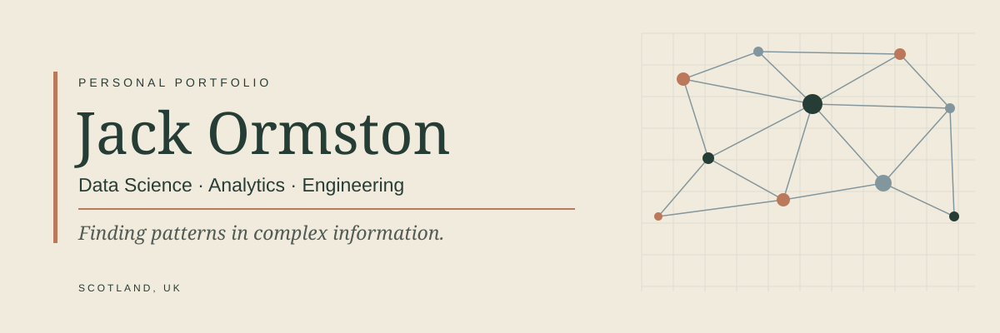

## A little about me

I'm a Data Scientist based in Scotland, with an MSc in Big Data and a background in customer analytics and business intelligence.

My route into data science began with understanding customers and business performance. These days, I'm particularly interested in machine learning, natural language processing, database design and the systems that connect them.

This is a space for my personal projects, experiments and research — a chance to explore ideas beyond my day-to-day work and bring some of my other interests into data science.

## Currently exploring

**Literary Character Network Intelligence**

I'm exploring how NLP and graph analytics can help us understand relationships between fictional characters, starting with Dostoevsky's *Crime and Punishment*.

One of the more interesting challenges is resolving the different names, patronymics and nicknames used for the same character. I'm developing a reproducible approach to character identification, interaction extraction and network analysis.

## Selected work

| Project | Focus |
| --- | --- |
| Literary Character Network Intelligence (in development) | NLP, entity resolution and graph analytics |
| Customer retention research (MSc dissertation) | Feature engineering, classification and model evaluation |

## Technical toolkit

## Repository insights

Language shares use GitHub-reported source bytes, not proficiency or time spent. Statistics exclude private, forked, archived and profile repositories.

## Education & professional development

## Beyond the code

I enjoy reading fiction, running and exploring creative technology. I'm particularly interested in projects that bring together subjects that might not ordinarily overlap.

I value reproducibility, thoughtful experimentation and understanding why a solution works, not simply whether it works.
